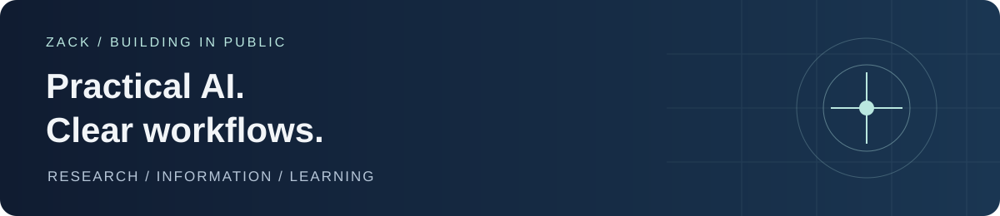

<picture>
  
</picture>

# Hi, I'm Zack 👋

I build practical AI tools for **research planning** and **making sense of information**.
My focus: clear starting points, traceable sources, and projects small enough to maintain.

**[Try Research Navigator →](https://github.com/Zack0303/research-navigator)** · **[中文介绍](README.zh-CN.md)**

## Find something useful

| 🎓 Research Navigator | 📰 AI News Monitor |
| :--- | :--- |
| **From a broad idea to a manageable research plan.** | **From scattered AI sources to a structured digest.** |
| For master's and PhD students: plan a proposal, review a draft, and distinguish verified requirements from advice. | Explore a pipeline that collects RSS and GitHub items, ranks them, and generates Chinese/English digests. |
| **Start in a web AI chat.** Copy the instruction file; no coding or Codex installation required for this route. English · Español · 中文. | **Explore the implementation.** Includes LLM analysis, heuristic fallback and static-page generation. Local setup is required to run the pipeline. |
| [**Start here →**](https://github.com/Zack0303/research-navigator) · [See a public review](https://github.com/Zack0303/research-navigator/blob/main/examples/public-mres-case.md) | [**Explore the project →**](https://github.com/Zack0303/AI-News-Monitor) · [中文说明](https://github.com/Zack0303/AI-News-Monitor/blob/master/README.zh-CN.md) |
| Experimental · MIT licensed · Human usability/language validation pending. Web-platform capabilities vary. | Experimental · Current live operation has not been verified. |

## What I'm working on

- Making Research Navigator easier to start with, including for students without a technical background.
- Keeping evidence, assumptions and limitations visible in AI-assisted workflows.
- Maintaining a focused portfolio rather than accumulating unfinished projects.

## Try it, then tell me what got in the way

Choose a project above, follow its starting instructions, and use a public or fictional example first.
If it helps, **star that project's repository** so you can find it again and support its development.
If something is confusing, [report it in Research Navigator](https://github.com/Zack0303/research-navigator/issues) or [AI News Monitor](https://github.com/Zack0303/AI-News-Monitor/issues). Include what you tried and what you expected; leave out confidential material.

Learning and reference repositories

[Movie Sentiment Analysis](https://github.com/Zack0303/movie-sentiment-analysis) is a learning baseline using TF-IDF and logistic regression. Other forks on this account are reference copies unless explicitly documented otherwise.

